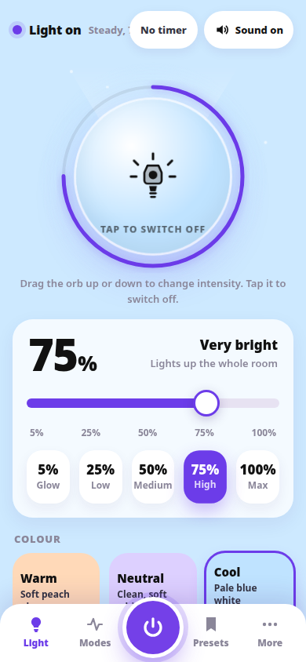

# Torch — The screen is the light

Torch is a torch app prototype where the screen itself is the light. One large orb switches it on, and brightness runs from 5 to 100 percent through a slider, preset chips, or dragging the orb, all kept in sync.

## What it does

- Screen-as-light orb with intensity from 5 to 100 percent, controlled by slider, presets, or orb drag.
- Warm, neutral, and cool light temperatures.
- Steady, Pulse, SOS, and Strobe modes. Strobe carries a photosensitivity warning.
- Auto-off timer, full-screen light mode, and saveable personal presets, with 3 starters included.
- Where the device supports it, the camera flash can be used too, and the app says plainly when it cannot.
- The light always starts OFF after a reload.

## Status

Working prototype, built November 2026. A signed Android APK of this app also exists.

## Showcase only

This repository is a showcase. It contains no source code and no build files, and nothing here is open source. The screenshot(s) above are showcase images only. See NOTICE.md.

## Contact

Built by Yash Dashrath, Pune, India.

- Email: yashdashrath18@gmail.com
- LinkedIn: https://www.linkedin.com/in/yash-dashrath
- Yash MediaWorks: https://www.linkedin.com/company/yashmediaworks/
